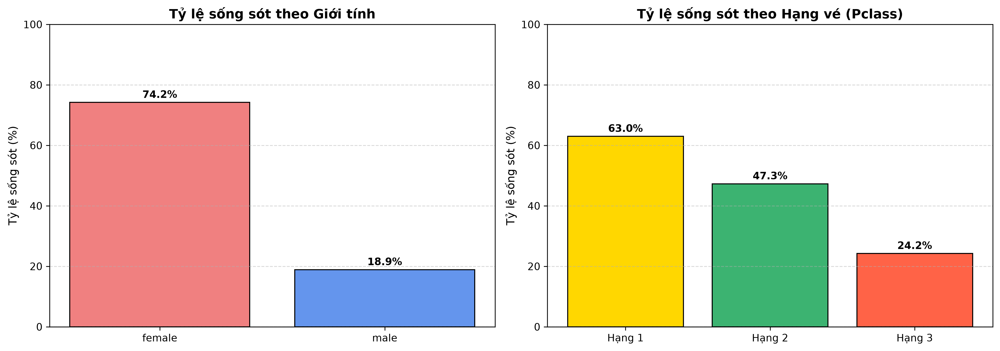
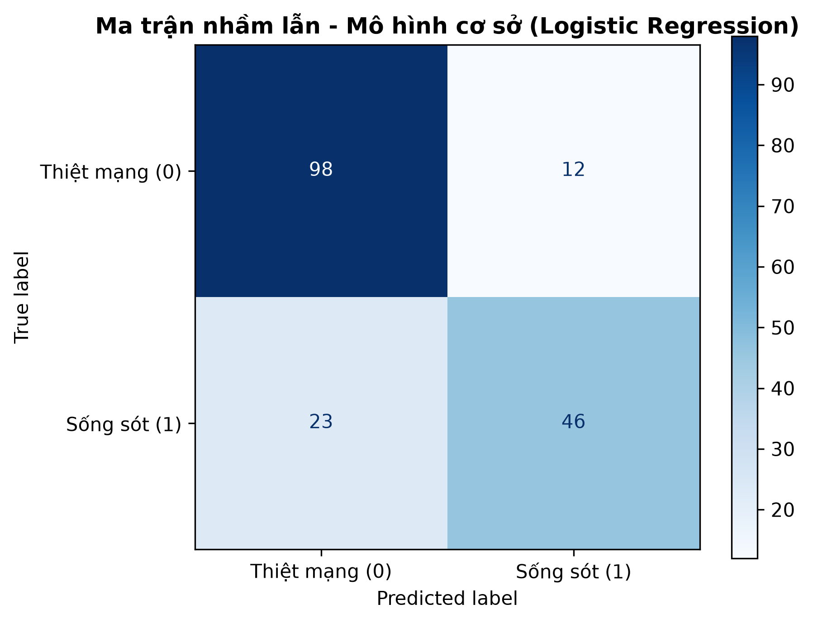
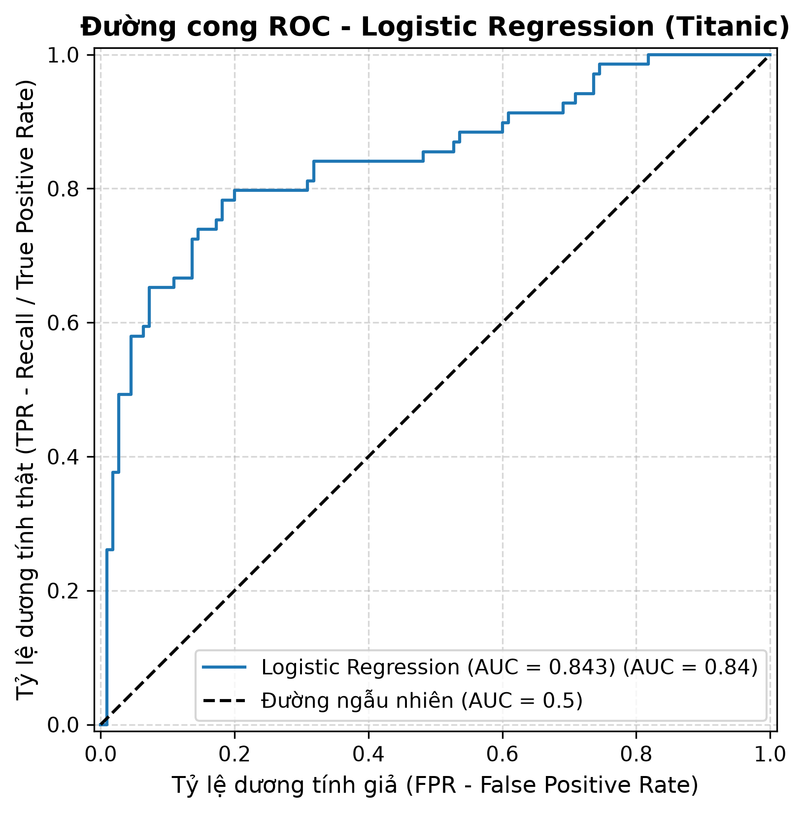

# BÁO CÁO ASSIGNMENT GIAI ĐOẠN 1: MÔ HÌNH CƠ SỞ (BASE MODEL)
**Môn học:** Học máy cơ bản (ITA202)  
**Đề tài:** Dự đoán khả năng sống sót trên tàu Titanic (Titanic Survival Prediction)  
**Sinh viên thực hiện:** Trương Văn Hoàn  
**Mã sinh viên:** PH64180  

---

## 1. GIỚI THIỆU DỰ ÁN & BÀI TOÁN

- **Bài toán:** Dự đoán hành khách trên tàu Titanic có sống sót hay không dựa trên các thông tin cá nhân và vé tàu (`Survived`: 0 = Thiệt mạng, 1 = Sống sót).
- **Phân loại bài toán (Theo vở ghi Note 1):** 
  - Đây là bài toán **Học máy có giám sát (Supervised Learning)** thuộc dạng **Phân loại nhị phân (Binary Classification)** vì nhãn đầu ra là nhãn rời rạc gồm 2 lớp $\{0, 1\}$.
- **Tập dữ liệu:** Bộ dữ liệu Titanic thực tế gồm **891 dòng** (hành khách) và **12 cột** (thuộc tính).

---

## 2. KHÁM PHÁ DỮ LIỆU (EXPLORATORY DATA ANALYSIS - EDA)

### 2.1. Cấu trúc dữ liệu (`Shape`, `Info`, `Describe`)
- **Kích thước:** `(891, 12)`.
- **Danh sách các cột:**
  - `PassengerId`, `Name`, `Ticket`: Các thuộc tính định danh cá nhân, không mang tính quy luật học máy.
  - `Pclass`: Hạng vé (1 = Hạng nhất, 2 = Hạng nhì, 3 = Hạng ba).
  - `Sex`: Giới tính (`male` / `female`).
  - `Age`: Độ tuổi của hành khách.
  - `SibSp`: Số lượng anh chị em / vợ chồng đi cùng.
  - `Parch`: Số lượng cha mẹ / con cái đi cùng.
  - `Fare`: Giá vé (USD thời kỳ 1912).
  - `Cabin`: Số phòng / khoang tàu.
  - `Embarked`: Cảng lên tàu (`C` = Cherbourg, `Q` = Queenstown, `S` = Southampton).
  - `Survived`: Nhãn mục tiêu cần dự đoán (Target).

### 2.2. Phân bố biến mục tiêu (Target Distribution)
- Số người thiệt mạng (`0`): **549 người (61.62%)**
- Số người sống sót (`1`): **342 người (38.38%)**

> **Nhận xét EDA:**
> - Phụ nữ có tỷ lệ sống sót vượt trội (**~74.2%**) so với nam giới (**~18.9%**) do ưu tiên "Phụ nữ và trẻ em trước".
> - Hành khách mua vé Hạng 1 có tỷ lệ sống sót cao nhất (**~63.0%**), trong khi hành khách Hạng 3 chịu thiệt hại nặng nhất (chỉ sống sót **~24.2%**).

---

## 3. LÀM SẠCH DỮ LIỆU (DATA CLEANING - THEO VỞ GHI NOTE 2)

Thống kê tỷ lệ giá trị thiếu (Missing Values - NaN):
- `Cabin`: Thiếu **687 giá trị (77.10%)**
- `Age`: Thiếu **177 giá trị (19.87%)**
- `Embarked`: Thiếu **2 giá trị (0.22%)**

### Quy trình xử lý theo chuẩn Vở ghi Note 2:
1. **Xử lý cột thiếu quá nhiều (> 50-60%):** Cột `Cabin` thiếu tới 77.1% $\rightarrow$ **Xóa bỏ (Drop)**.
2. **Loại bỏ cột nhiễu:** Xóa `PassengerId`, `Name`, `Ticket` để tránh mô hình học vẹt (overfitting).
3. **Điền giá trị thiếu (Imputation):**
   - Cột `Age`: Điền khuyết bằng **Trung vị (Median = 28.0 tuổi)** do phân phối độ tuổi bị lệch.
   - Cột `Embarked`: Điền khuyết bằng **Yếu vị (Mode = 'S')** là cảng có số lượng người lên tàu đông nhất.
4. **Xử lý ngoại lệ (Outliers):**
   - Cột giá vé `Fare` có một số vé VIP lên tới 512$ (cách rất xa phần còn lại). Áp dụng kỹ thuật **Cắt biên (Winsorization tại percentile 99: 249.01$)** để loại bỏ tác động tiêu cực của ngoại lệ mà không làm mất dữ liệu.

---

## 4. TIỀN XỬ LÝ & CHỐNG RÒ RỈ DỮ LIỆU (PREPROCESSING & DATA LEAK)

- **Chia tập dữ liệu:** Chia tỷ lệ **80% Train (712 mẫu)** và **20% Test (179 mẫu)**, có phân tầng nhãn `stratify=y` và cố định `random_state=42`.
- **Nguyên tắc chống rò rỉ dữ liệu (Theo Note 2):** Tuyệt đối không cho mô hình nhìn thấy tập Test trước.
- **Xây dựng `ColumnTransformer` & `Pipeline`:**
  - **Nhóm thuộc tính số (`Age`, `Fare`, `SibSp`, `Parch`):** Chuẩn hóa bằng **`StandardScaler`** để đưa về phân phối chuẩn ($\mu = 0, \sigma = 1$), tránh việc cột `Fare` lấn át cột `Age`.
  - **Nhóm thuộc tính phân loại (`Sex`, `Embarked`, `Pclass`):** Mã hóa bằng **`OneHotEncoder(drop='first')`** để chuyển thành các cột nhị phân $(0, 1)$, tránh gán thứ tự sai lệch.

---

## 5. MÔ HÌNH CƠ SỞ & KẾT QUẢ ĐÁNH GIÁ (LOGISTIC REGRESSION - THEO NOTE 4)

Huấn luyện mô hình cơ sở **Logistic Regression** (sử dụng hàm kích hoạt Sigmoid với ngưỡng quyết định $0.5$):

### 5.1. Bảng chỉ số đánh giá trên tập Test

| Chỉ số đánh giá | Giá trị | Ý nghĩa thực tế (Theo Vở ghi Note 4) |
| :--- | :---: | :--- |
| **Accuracy (Độ chính xác)** | **80.45%** | Tỷ lệ dự đoán đúng tổng thể đạt trên 80% ngay ở mô hình cơ sở. |
| **Precision (Độ chuẩn xác)** | **79.31%** | *"Không bắt nhầm"*: Trong số những người mô hình đoán sống sót, có 79.31% là sống sót thật. |
| **Recall (Độ thu hồi)** | **66.67%** | *"Không bỏ sót"*: Trong số tất cả người sống sót ngoài đời, mô hình tìm ra được 66.67%. |
| **F1-Score** | **0.7244** | Trung bình điều hòa cân bằng giữa Precision và Recall. |
| **ROC - AUC** | **0.8431** | Thước đo năng lực phân tách tổng thể ($AUC = 0.843$ thể hiện khả năng phân biệt tốt). |

### 5.2. Ma trận nhầm lẫn (Confusion Matrix 2x2)

- **TN (True Negative = 98):** Thực tế thiệt mạng và đoán đúng là thiệt mạng.
- **TP (True Positive = 46):** Thực tế sống sót và đoán đúng là sống sót.
- **FP (False Positive = 12):** Bắt nhầm (Thực tế thiệt mạng nhưng đoán sống sót).
- **FN (False Negative = 23):** Bỏ sót (Thực tế sống sót nhưng đoán thiệt mạng).

### 5.3. Đường cong ROC - AUC

Đường cong ROC cong mạnh về góc trên bên trái với diện tích dưới đường cong **$AUC = 0.843$**, vượt xa đường dự đoán ngẫu nhiên ($AUC = 0.5$).

---

## 6. KẾT LUẬN & ĐỊNH HƯỚNG GIAI ĐOẠN 2

### Đánh giá Giai đoạn 1:
- Đã hoàn thành xuất sắc toàn bộ chu trình Machine Learning cơ sở từ khâu tiền xử lý dữ liệu thô đến đánh giá mô hình.
- Mô hình cơ sở Logistic Regression đạt hiệu suất tốt (**80.45%**).

### Kế hoạch triển khai Giai đoạn 2 (Tối ưu hóa & Hoàn thiện):
1. **Thử nghiệm các thuật toán phi tuyến tính nâng cao:** **KNN**, **Decision Tree**, **Random Forest** để nâng cao chỉ số Recall và F1-Score.
2. **Kỹ thuật trích xuất đặc trưng (Feature Engineering):** Tạo thêm các đặc trưng mới từ `SibSp` và `Parch` (ví dụ: `FamilySize = SibSp + Parch + 1`).
3. **Tối ưu siêu tham số:** Sử dụng **GridSearchCV** kết hợp **K-Fold Cross-Validation** (5-Fold).
4. **Đóng gói sản phẩm:** Đóng gói toàn bộ Pipeline tốt nhất và lưu ra file **`best_model.pkl`** bằng thư viện `joblib`.
