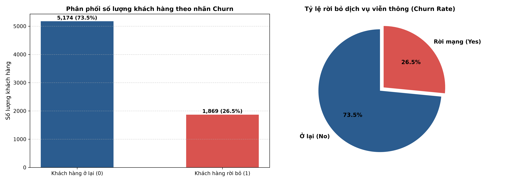

# BÀI TẬP LỚN / ASSIGNMENT GIAI ĐOẠN 1
## MÔN: HỌC MÁY CƠ BẢN (ITA202) - FPT POLYTECHNIC

### 1. Giới thiệu bài toán & Dữ liệu
- **Bài toán:** Dự báo nguy cơ khách hàng hủy dịch vụ viễn thông (`Churn: Yes/No`).
- **Dữ liệu gốc:** 7.043 dòng x 21 cột (1 mã định danh `customerID`, 4 thông tin nhân khẩu học, 9 dịch vụ viễn thông, 6 thông tin hợp đồng & thanh toán, 1 biến mục tiêu `Churn`).
- **Tỷ lệ phân phối mục tiêu:**
  - `No` (Ở lại): 5.174 khách hàng (~73.46%)
  - `Yes` (Rời mạng): 1.869 khách hàng (~26.54%)

---

### 2. Các bước tiền xử lý dữ liệu đã thực hiện
1. **Khám phá dữ liệu (EDA):** Kiểm tra `shape`, `info()` và `describe()`; thống kê phân phối nhãn Churn.
2. **Loại bỏ thuộc tính không cần thiết:** Drop cột `customerID` (mã ngẫu nhiên không có giá trị học máy).
3. **Phát hiện & xử lý dữ liệu khuyết thiếu / sai kiểu:**
   - Cột `TotalCharges` có 11 dòng mang chuỗi khoảng trắng `' '`.
   - Toàn bộ 11 dòng này đều có `tenure = 0` (khách hàng mới đăng ký trong tháng đầu tiên).
   - Chuyển sang dạng `float` và điền giá trị `0.0`.
4. **Phát hiện & xử lý ngoại lệ:** Dùng Boxplot để khảo sát và ngưỡng IQR (1.5 × IQR) học từ Train cho `tenure`, `MonthlyCharges`, `TotalCharges`. Lần chạy hiện tại không có điểm nào vượt ngưỡng nên không làm thay đổi giá trị hay loại bỏ khách hàng; code vẫn chặn giá trị ngoài ngưỡng nếu phát sinh.
5. **Mã hóa biến mục tiêu và biến nhị phân:**
   - `Churn`: 'No' -> 0, 'Yes' -> 1
   - `gender`: 'Female' -> 0, 'Male' -> 1
   - `Partner`, `Dependents`, `PhoneService`, `PaperlessBilling`: 'No' -> 0, 'Yes' -> 1
6. **Mã hóa các biến danh mục (One-Hot Encoding):** Áp dụng `pd.get_dummies(..., drop_first=True)` cho 10 biến phân loại nhằm chống bẫy biến giả (Dummy Variable Trap).
7. **Chia tập và chuẩn hóa:** Chia Train/Test theo tỷ lệ 80:20 (`random_state=42`, stratify theo Churn); ngưỡng IQR và `StandardScaler` chỉ fit trên Train.
8. **Xuất file dữ liệu sạch:** Lưu tại `asm/data/telco_churn_preprocessed.csv` (7.043 dòng x 31 cột), áp dụng cùng ngưỡng IQR và scaler học từ Train.

---

### 3. Kết quả đánh giá mô hình cơ sở (Baseline Logistic Regression)
- **Độ chính xác (Accuracy):** **80.62%**
- **Precision:** 0.6593
- **Recall:** 0.5588
- **F1-Score:** 0.6049
- **ROC-AUC Score:** **0.8422**

---

### 4. Hình ảnh minh chứng kết quả chạy thực nghiệm

#### Dashboard kết quả tiền xử lý (Link 3):

#### Phân phối nhãn mục tiêu Churn:

#### Boxplot thâm niên (tenure) và cước phí tháng theo nhãn Churn:

---

### 5. Kết luận Giai đoạn 1
- Đã hoàn thành EDA, làm sạch dữ liệu, mã hóa, chuẩn hóa và chia tập dữ liệu.
- Đã huấn luyện và đánh giá mô hình baseline Logistic Regression bằng các chỉ số Accuracy, Precision, Recall, F1-Score và ROC-AUC.
- Dữ liệu sau xử lý và các biểu đồ minh chứng đã sẵn sàng để nộp.
