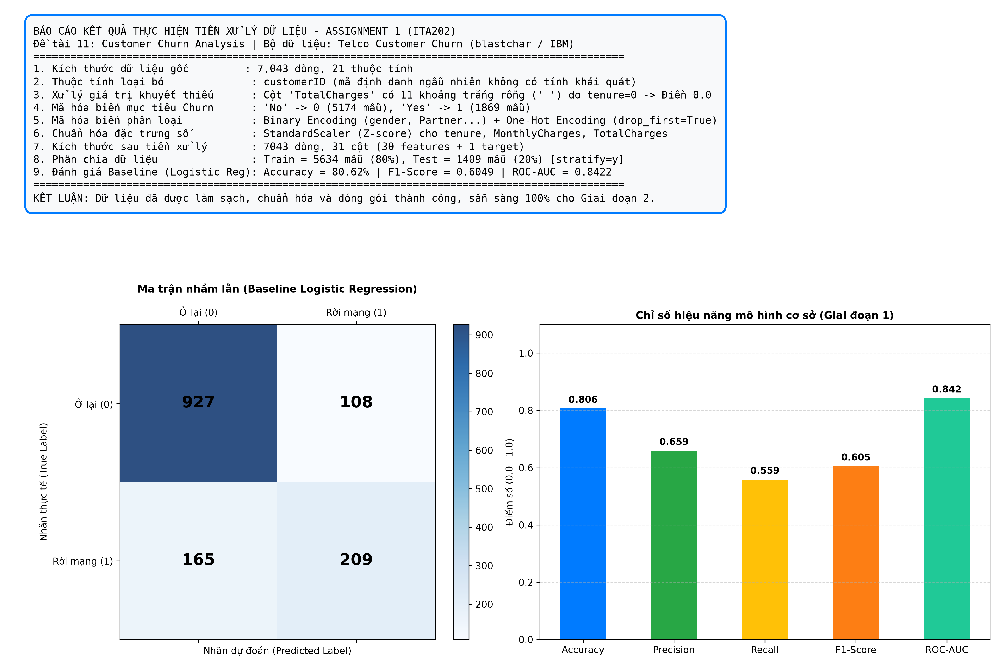
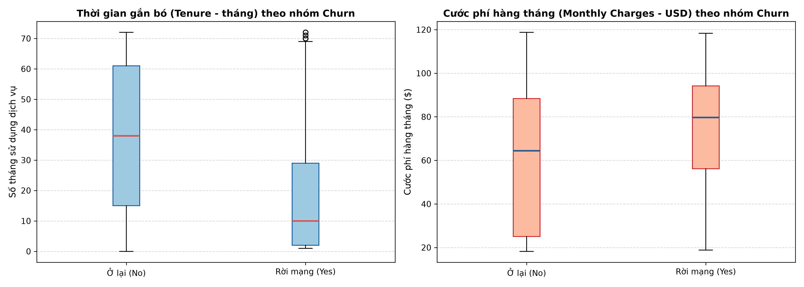

# BÀI TẬP LỚN / ASSIGNMENT GIAI ĐOẠN 1
## MÔN: HỌC MÁY CƠ BẢN (ITA202) - FPT POLYTECHNIC

---

### THÔNG TIN NỘP BÀI ASSIGNMENT 1 (HẠN: 23H59 CHỦ NHẬT)
- **Đề tài:** **Đề tài 11 - Phân tích hành vi và dự báo rời bỏ dịch vụ của khách hàng (Customer Churn Analysis)**
- **Bộ dữ liệu:** Telco Customer Churn (IBM Developer / Kaggle blastchar)
- **File báo cáo Word chính thức:** [`ASSIGNMENT_1_HOAN31.docx`](../ASSIGNMENT_1_HOAN31.docx) (hoặc [`asm/ASSIGNMENT_1_HOAN31.docx`](ASSIGNMENT_1_HOAN31.docx))

---

### BẢNG 3 LIÊN KẾT NỘP BÀI CHÍNH THỨC THEO YÊU CẦU

| Mục nộp | Nội dung chi tiết | Liên kết trực tiếp |
| :--- | :--- | :--- |
| **Link 1: Mã nguồn** | Script Python thực hiện đầy đủ quy trình tiền xử lý dữ liệu và huấn luyện mô hình cơ sở | [**Xem mã nguồn tại GitHub**](https://github.com/HOAN31/hoc_may_co_ban/blob/main/asm/tien_xu_ly_telco.py) |
| **Link 2: Dữ liệu sau xử lý** | Tập dữ liệu Telco Customer Churn sau khi làm sạch, mã hóa và chuẩn hóa (7.043 dòng x 31 cột) | [**Tải dữ liệu tại GitHub**](https://github.com/HOAN31/hoc_may_co_ban/blob/main/asm/data/telco_churn_preprocessed.csv) |
| **Link 3: Ảnh chụp kết quả** | Ảnh chụp bảng Dashboard minh chứng kết quả chạy tiền xử lý và đánh giá Baseline Model | [**Xem ảnh kết quả tại GitHub**](https://github.com/HOAN31/hoc_may_co_ban/blob/main/asm/images/ket_qua_chay_tien_xu_ly.png) |

---

### 1. Giới thiệu bài toán & Dữ liệu
- **Bài toán:** Dự báo nguy cơ khách hàng hủy dịch vụ viễn thông (`Churn: Yes/No`).
- **Dữ liệu gốc:** 7.043 dòng x 21 cột (1 mã định danh `customerID`, 4 thông tin nhân khẩu học, 9 dịch vụ viễn thông, 6 thông tin hợp đồng & thanh toán, 1 biến mục tiêu `Churn`).
- **Tỷ lệ phân phối mục tiêu:**
  - `No` (Ở lại): 5.174 khách hàng (~73.46%)
  - `Yes` (Rời mạng): 1.869 khách hàng (~26.54%)

---

### 2. Các bước tiền xử lý dữ liệu đã thực hiện
1. **Khám phá dữ liệu (EDA):** Thống kê mô tả số lượng dòng, cột, kiểu dữ liệu, xác định các trường dạng chuỗi (`object`) và phân phối nhãn.
2. **Loại bỏ thuộc tính không cần thiết:** Drop cột `customerID` (mã ngẫu nhiên không có giá trị học máy).
3. **Phát hiện & xử lý dữ liệu khuyết thiếu / sai kiểu:**
   - Cột `TotalCharges` có 11 dòng mang chuỗi khoảng trắng `' '`.
   - Toàn bộ 11 dòng này đều có `tenure = 0` (khách hàng mới đăng ký trong tháng đầu tiên).
   - Chuyển sang dạng `float` và điền giá trị `0.0`.
4. **Mã hóa biến mục tiêu và biến nhị phân:**
   - `Churn`: 'No' -> 0, 'Yes' -> 1
   - `gender`: 'Female' -> 0, 'Male' -> 1
   - `Partner`, `Dependents`, `PhoneService`, `PaperlessBilling`: 'No' -> 0, 'Yes' -> 1
5. **Mã hóa các biến danh mục (One-Hot Encoding):** Áp dụng `pd.get_dummies(..., drop_first=True)` cho 10 biến phân loại nhằm chống bẫy biến giả (Dummy Variable Trap).
6. **Chuẩn hóa đặc trưng số (Feature Scaling):** Áp dụng `StandardScaler` cho `tenure`, `MonthlyCharges`, `TotalCharges` (đưa về Mean = 0, Std = 1).
7. **Xuất file dữ liệu sạch:** Lưu tại `asm/data/telco_churn_preprocessed.csv` (7.043 dòng x 31 cột).

---

### 3. Kết quả đánh giá mô hình cơ sở (Baseline Logistic Regression)
- **Độ chính xác (Accuracy):** **80.62%**
- **Precision:** 0.6593
- **Recall:** 0.5588
- **F1-Score:** 0.6049
- **ROC-AUC Score:** **0.8422**

---

### 4. Hình ảnh minh chứng kết quả chạy thực nghiệm

#### Dashboard kết quả tiền xử lý (Link 3):

#### Phân phối nhãn mục tiêu Churn:

#### Tương quan giữa thâm niên (tenure) & cước phí tháng với việc rời mạng:

---

### 5. Kế hoạch triển khai Giai đoạn 2
- Thử nghiệm mô hình nâng cao: **KNN, Decision Tree, Random Forest**.
- Tinh chỉnh siêu tham số bằng **GridSearchCV** kết hợp **5-Fold Cross-Validation**.
- Xử lý vấn đề mất cân bằng dữ liệu bằng `class_weight='balanced'`.
- Đóng gói mô hình tối ưu ra file `.pkl` bằng `joblib`.
