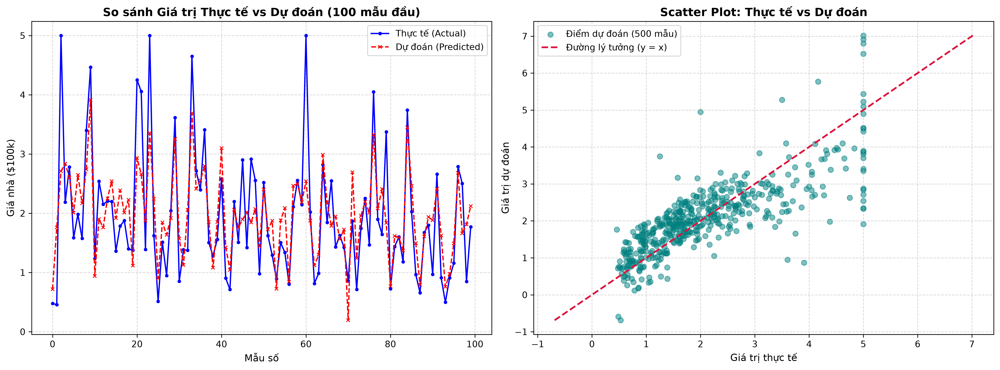

# Lab 3: Hồi Quy Tuyến Tính (Linear Regression)

---

## 🎯 Mục tiêu
- Hiểu bài toán Hồi quy (Regression) và cách áp dụng mô hình Tuyến tính.
- Huấn luyện mô hình Hồi quy tuyến tính trên tập dữ liệu thực tế.
- Đánh giá chất lượng mô hình bằng các chỉ số: **MAE** (Mean Absolute Error), **MSE** (Mean Squared Error), **RMSE**, và **R-squared ($R^2$)**.
- Trực quan hóa kết quả dự đoán của mô hình bằng thư viện **Matplotlib**.

---

## 📋 Nội dung các bài tập

### Bài 1: Xây dựng mô hình Hồi quy tuyến tính cơ bản
- Tạo dữ liệu giả lập có quan hệ tuyến tính: $y = 2X + 1 + \text{nhiễu Gauss}$.
- Huấn luyện mô hình bằng `sklearn.linear_model.LinearRegression`.
- In và đối chiếu các hệ số học được:
  - Hệ số góc (Weight / `coef_`)
  - Hệ số chặn (Bias / `intercept_`)

### Bài 2: Đánh giá mô hình trên tập dữ liệu Diabetes
- Sử dụng tập dữ liệu bệnh tiểu đường `diabetes` từ `sklearn.datasets`.
- Lấy 1 đặc trưng duy nhất: `bmi` (Chỉ số khối cơ thể) để dự đoán mức độ tiến triển của bệnh.
- Chia dữ liệu theo tỷ lệ 80% Train / 20% Test.
- **Tính toán và giải thích ý nghĩa các chỉ số đánh giá:**
  1. **MAE (Mean Absolute Error):** Đo độ lệch trung bình giữa thực tế và dự đoán; trực quan, cùng đơn vị với biến mục tiêu.
  2. **MSE (Mean Squared Error):** Đo trung bình bình phương sai số; phạt nặng các sai số lớn do có phép bình phương, rất nhạy với các điểm dị biệt (outliers).
  3. **RMSE (Root Mean Squared Error):** Căn bậc hai của MSE để đưa sai số về cùng đơn vị gốc với dữ liệu.
  4. **R-squared ($R^2$ Score):** Đo lường tỷ lệ phần trăm độ biến thiên của biến phụ thuộc được mô hình giải thích (càng gần 1 mô hình khớp càng tốt).

### Bài 3: Trực quan hóa kết quả (Matplotlib)
- Dùng `matplotlib.pyplot` vẽ biểu đồ tán xạ (scatter plot) của các điểm dữ liệu thực tế trên tập Test.
- Vẽ đường thẳng hồi quy của mô hình trên cùng biểu đồ để so sánh.
- Xuất file ảnh đồ thị: `bai3_linear_regression.png`.

### Bài 4: Quy trình ML hoàn chỉnh - Hồi quy California Housing
- Sử dụng tập dữ liệu giá nhà California (`fetch_california_housing` gồm 20,640 mẫu, 8 đặc trưng).
- Thực hiện quy trình khép kín:
  $$\text{Load} \rightarrow \text{Preprocess (StandardScaler)} \rightarrow \text{Train (LinearRegression)} \rightarrow \text{Evaluate (MSE, MAE, } R^2) \rightarrow \text{Visualize}$$
- Trực quan hóa 2 biểu đồ so sánh: biểu đồ đường (100 mẫu đầu) và biểu đồ phân tán kèm đường lý tưởng $y = x$.
- Xuất file ảnh đồ thị: `bai4_california_results.png`.

### Bài 5: Phần mở rộng (Giảng viên giao thêm)
- Thử nghiệm mô hình **Ridge Regression (chuẩn hóa $L_2$)** để kiểm soát hiện tượng overfitting.
- So sánh bảng chỉ số hiệu năng giữa `Linear Regression` và `Ridge Regression`.

---

## 🖼️ Kết quả trực quan hóa

| Biểu đồ Bài 3 (Diabetes) | Biểu đồ Bài 4 (California Housing) |
| :---: | :---: |
|  |  |

---

## 🚀 Hướng dẫn chạy

```bash
python lab3.py
```
