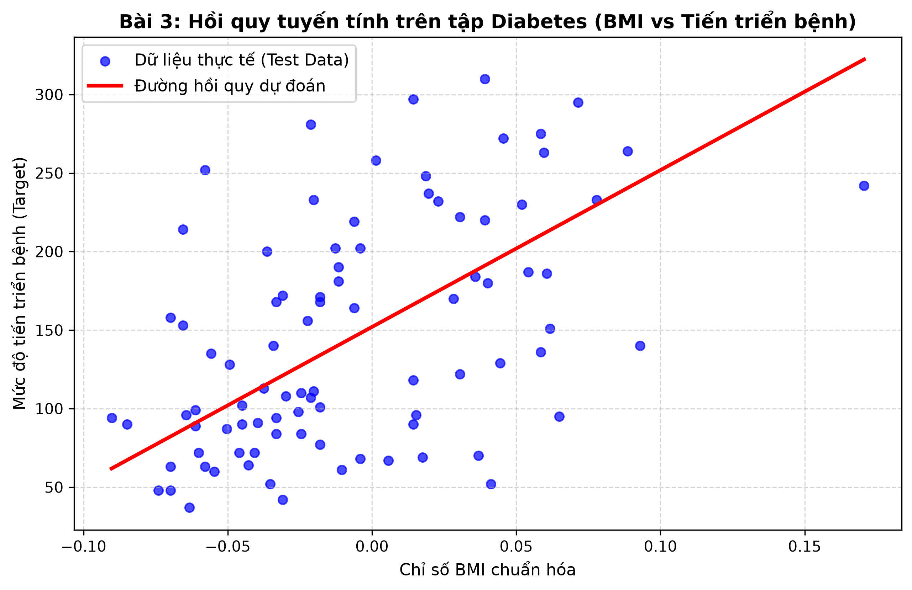

# Lab 3: Hồi Quy Tuyến Tính (Linear Regression)

Kho lưu trữ và hướng dẫn thực hành **Lab 3: Hồi quy tuyến tính** (đối chiếu theo đề bài `ITA202-Lab3.pdf` và vở ghi chép bài học `Note3_ITA202.pdf`).

---

## 🎯 Mục tiêu & Lý thuyết cốt lõi (Theo Vở Ghi Note 3)
- **Bản chất bài toán Hồi quy (Regression):**
  - Dự đoán 1 biến mục tiêu có giá trị liên tục (một con số cụ thể, ví dụ: Giá nhà, Doanh thu, Nhiệt độ...).
  - **Hồi quy đơn biến (Simple Linear Regression):** 1 biến đầu vào $X$ và 1 biến đầu ra $y$:
    $$y = aX + b$$
    Trong đó: $a$ là hệ số góc (slope/weight - mức độ tác động của $X$ lên $y$); $b$ là hệ số chặn (intercept - giá trị khởi đầu của $y$ khi $X = 0$).
  - **Cơ chế tối ưu hóa:** Tìm đường thẳng đi sát qua các điểm dữ liệu nhất sao cho tổng khoảng cách sai số là nhỏ nhất.
    - Phương pháp bình phương tối thiểu (**OLS** - Ordinary Least Squares).
    - Hàm mất mát (**MSE** - Mean Squared Error): Thước đo độ "tệ" của mô hình; $MSE$ càng nhỏ mô hình càng chính xác.
    - Thuật toán Gradient: Máy tính tự động dò tìm bộ tham số tối ưu thông qua tốc độ học (Learning Rate).
- **Hệ thống chỉ số đánh giá:**
  - **MAE:** Sai số tuyệt đối trung bình.
  - **MSE & RMSE:** $RMSE = \sqrt{MSE}$ giữ nguyên đơn vị gốc của $y$, nhấn mạnh phạt nặng các lỗi dự đoán lớn.
  - **$R^2$ (Hệ số xác định):** Mô hình giải thích được bao nhiêu % độ biến động của dữ liệu.
    - **Thế nào được coi là tốt?** $R^2 > 0.7$ ($> 70\%$).
    - **Tại sao mô hình BMI chỉ đạt ~ 23.34% ($< 70\%$)?** Do chỉ dùng 1 biến duy nhất và chịu ảnh hưởng của các điểm ngoại lệ (Outliers).
    - **Cách cải thiện (Theo vở ghi):** Chuyển sang hồi quy đa biến ($y = a_1 X_1 + a_2 X_2 + ... + b$), xử lý điểm ngoại lệ, thu thập thêm đặc trưng chất lượng, biến đổi log.

---

## 📋 Nội dung các bài tập

### Bài 1: Xây dựng mô hình Hồi quy tuyến tính
- Tạo dữ liệu giả lập tuyến tính: $y = 2X + 1 + \text{nhiễu Gauss}$.
- Huấn luyện với `LinearRegression` và in đối chiếu hệ số góc ($w$) cùng hệ số chặn ($b$).

### Bài 2: Đánh giá mô hình trên tập Diabetes (Đặc trưng BMI)
- Lấy riêng đặc trưng BMI (`X = data.data[:, [2]]`).
- Chia Train/Test theo tỷ lệ 80/20.
- Tính toán và giải thích chi tiết các chỉ số: MAE, MSE, RMSE, $R^2$.

### Bài 3: Trực quan hóa kết quả (Matplotlib)
- Vẽ biểu đồ tán xạ (scatter plot) của dữ liệu thực tế và vẽ đường thẳng hồi quy màu đỏ trên cùng đồ thị.
- Xuất file ảnh đồ thị: `bai3_linear_regression.png`.

### Bài 4: Quy trình ML hoàn chỉnh - Hồi quy đa biến California Housing
- Mở rộng sang hồi quy đa biến với 8 đặc trưng để khắc phục nhược điểm của hồi quy đơn biến.
- Đóng gói quy trình bằng `Pipeline(StandardScaler -> LinearRegression)`.
- $R^2$ tăng vọt lên **`57.58%`** (cải thiện rõ rệt so với 23.34% của mô hình 1 biến).
- Trực quan hóa so sánh Thực tế vs Dự đoán, xuất file ảnh: `bai4_california_results.png`.

### Bài 5: Phần mở rộng (Ridge Regression)
- Áp dụng mô hình hồi quy Ridge (chuẩn hóa $L_2$) để hạn chế overfitting.
- So sánh bảng chỉ số giữa Linear Regression và Ridge Regression.

---

## 🖼️ Kết quả trực quan hóa

| Biểu đồ Bài 3 (Diabetes) | Biểu đồ Bài 4 (California Housing) |
| :---: | :---: |
|  |  |

---

## 🚀 Hướng dẫn chạy

```bash
python lab3.py
```
