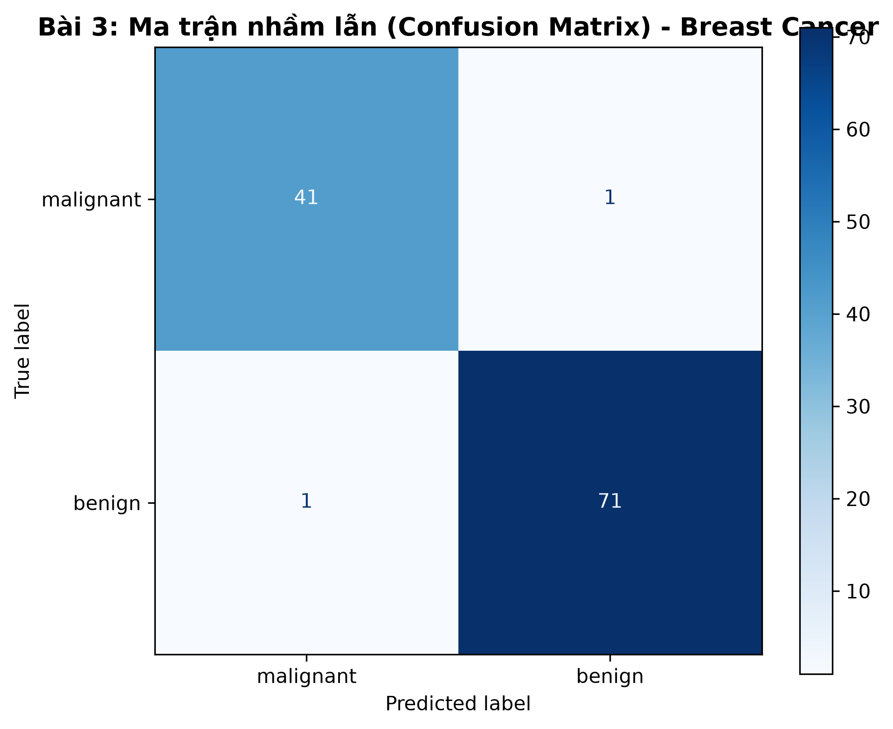
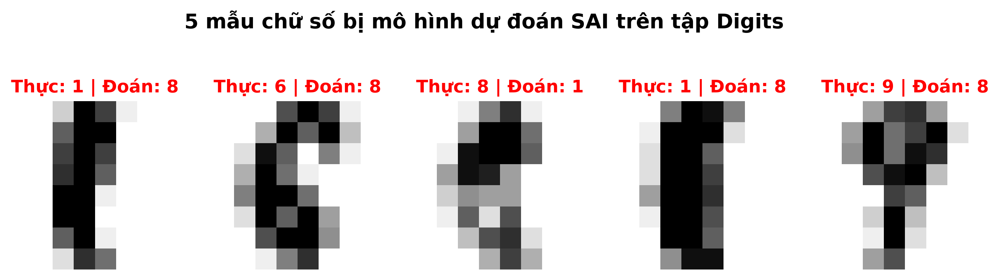
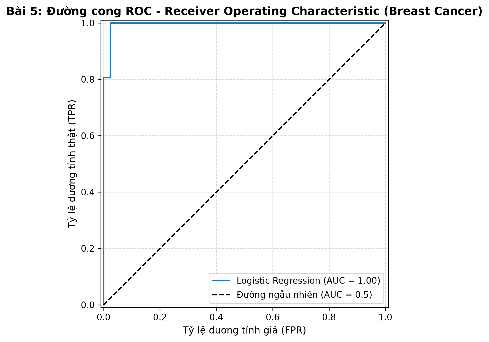

# Lab 4: Phân Loại – Logistic Regression

Kho lưu trữ và hướng dẫn thực hành **Lab 4: Phân loại – Logistic Regression** (kết hợp theo đề bài `ITA202-Lab4.pdf` và vở ghi chép bài học `NOte4_ITA202.pdf`).

---

## 🎯 Mục tiêu
- **Bản chất bài toán Phân loại (Classification):**
  - Nếu Hồi quy (Regression) trả lời câu hỏi *"Bao nhiêu?"* (giá trị liên tục), thì Phân loại dùng để quyết định và phân chia đối tượng vào các nhóm/lớp *"Cái nào?"* (nhãn rời rạc).
  - Hạn chế của Linear Regression khi phân loại: Đầu ra không bị chặn trong $[0, 1]$, khó xác định ngưỡng phân loại.
  - Logistic Regression giải quyết bài toán bằng cách sử dụng **hàm Sigmoid** $\sigma(z) = \frac{1}{1 + e^{-z}}$ để nén đầu ra về khoảng $[0, 1]$ biểu diễn xác suất, với **ngưỡng quyết định mặc định là 0.5** ($P \ge 0.5 \Rightarrow$ lớp 1).
- **Hệ thống chỉ số đánh giá toàn diện:**
  - **Accuracy (Độ chính xác):** Tỷ lệ dự đoán đúng trên tổng số mẫu.
  - **Ma trận nhầm lẫn (Confusion Matrix):** Bảng $2 \times 2$ phân loại chi tiết các trường hợp.
  - **Precision:** *"Không bắt nhầm"* (Độ chuẩn xác).
  - **Recall:** *"Không bỏ sót"* (Độ thu hồi / độ nhạy).
  - **F1-Score:** Trung bình điều hòa giữa Precision và Recall.
  - **ROC - AUC:** Đo lường năng lực phân tách tổng thể giữa các lớp ($AUC$ càng gần 1 càng tốt).

---

## 📋 Nội dung các bài tập

### Bài 1: Xây dựng mô hình Logistic Regression (Breast Cancer)
- Sử dụng tập dữ liệu phân loại ung thư vú `load_breast_cancer` (569 mẫu, 30 đặc trưng).
- Hai lớp nhãn: `malignant` (0 - Ác tính) và `benign` (1 - Lành tính).
- Phân chia tập dữ liệu 80% Train - 20% Test (`stratify=y`).
- Chuẩn hóa đặc trưng bằng `StandardScaler`.
- Khởi tạo và huấn luyện mô hình `LogisticRegression(max_iter=1000)`.

### Bài 2: Đánh giá mô hình phân loại trên tập Test
- Dự đoán nhãn lớp và xác suất trên tập Test.
- **Kết quả các chỉ số thực tế:**
  - **Accuracy:** `0.9825` (98.25%)
  - **Precision:** `0.9861` (khả năng không bắt nhầm đạt 98.61%)
  - **Recall:** `0.9861` (khả năng không bỏ sót ca bệnh đạt 98.61%)
  - **F1-Score:** `0.9861`
  - **AUC:** `0.9954`
- Xuất báo cáo phân loại chi tiết bằng `classification_report`.

### Bài 3: Ma trận nhầm lẫn (Confusion Matrix)
- Khởi tạo ma trận nhầm lẫn từ kết quả dự đoán với `confusion_matrix`.
- **Giải thích 4 thành phần theo vở ghi:**
  - **TP (True Positive - 71 ca):** Thực tế là Lành tính (1) và mô hình đoán đúng là Lành tính (1).
  - **TN (True Negative - 41 ca):** Thực tế là Ác tính (0) và mô hình đoán đúng là Ác tính (0).
  - **FP (False Positive - 1 ca):** Bắt nhầm (Thực tế là Ác tính nhưng đoán nhầm thành Lành tính).
  - **FN (False Negative - 1 ca):** Bỏ sót (Thực tế là Lành tính nhưng đoán nhầm thành Ác tính).
- Trực quan hóa ma trận bằng `ConfusionMatrixDisplay` và lưu vào file `bai3_confusion_matrix.png`.

### Bài 4: Quy trình ML hoàn chỉnh - Phân loại đa lớp Digits (0 - 9)
- Sử dụng tập dữ liệu 1,797 ảnh chữ số viết tay `load_digits` (10 lớp từ 0 đến 9).
- Đóng gói quy trình khép kín bằng `Pipeline(StandardScaler -> LogisticRegression)`.
- Đánh giá trên tập Test: Đạt **Accuracy = 97.22%** (chỉ sai 10 / 360 mẫu test).
- Tìm, in danh sách và hiển thị ảnh của **5 mẫu dự đoán sai đầu tiên** (lưu ảnh `bai4_digits_misclassified.png`).

### Bài 5: Phần mở rộng (Theo vở ghi - Đường cong ROC & AUC)
- Vẽ đường cong ROC (Receiver Operating Characteristic) đối chiếu với đường ngẫu nhiên ($AUC = 0.5$).
- Chỉ số $AUC$ đạt **0.9954**, chứng minh mô hình phân tách cực kỳ xuất sắc giữa hai lớp bệnh.
- Xuất ảnh đồ thị `bai5_roc_curve.png`.

---

## 🖼️ Kết quả trực quan hóa

| Ma trận nhầm lẫn (Bài 3) | 5 mẫu đoán sai tập Digits (Bài 4) | Đường cong ROC (Bài 5) |
| :---: | :---: | :---: |
|  |  |  |

---

## 🚀 Hướng dẫn chạy

```bash
python lab4.py
```
